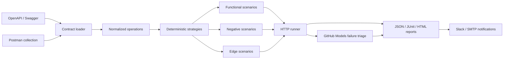

# Architecture

API Test Pilot keeps contract parsing, strategy generation, HTTP execution, provider integrations,
and output adapters independent. This lets teams add a new contract format or report destination
without changing the runner.

## Cohesion boundaries

- `loaders` owns retrieval and JSON/YAML decoding.
- `contracts` owns format detection and normalization.
- `generation` owns deterministic scenario strategies.
- `runner` owns HTTP execution and observed outcomes.
- `ai` owns the optional GitHub Models boundary.
- `reporting` owns JSON, JUnit XML, and HTML serialization.
- `notifications` owns Slack and SMTP delivery.
- `cli` composes those modules without embedding domain logic.

AI is additive: deterministic test generation and execution work offline. Failure payloads exclude
request headers and bodies to reduce the chance of transmitting credentials or sensitive data.
