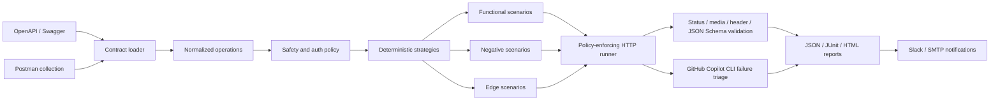

# Architecture

API Test Pilot keeps contract parsing, strategy generation, HTTP execution, provider integrations,
and output adapters independent. This lets teams add a new contract format or report destination
without changing the runner.

## Cohesion boundaries

- `loaders` owns retrieval and JSON/YAML decoding.
- `contracts` owns format detection and normalization.
- `generation` owns deterministic scenario strategies.
- `configuration` owns the shared local/CI project contract.
- `workflow` renders target-independent GitHub Actions from project configuration.
- `authentication` injects ephemeral environment credentials without persisting values.
- `validation` owns response media type, header, and JSON Schema assertions.
- `runner` enforces method policy, performs HTTP execution, and records observed outcomes.
- `ai` owns the optional, constrained GitHub Copilot CLI boundary.
- `reporting` owns JSON, JUnit XML, and HTML serialization.
- `notifications` owns Slack and SMTP delivery.
- `cli` composes those modules without embedding domain logic.

AI is additive: deterministic test generation and execution work offline. Failure payloads exclude
request headers and bodies to reduce the chance of transmitting credentials or sensitive data.

## Safety boundary

The configuration, generated suite, and runner each preserve an explicit HTTP method allowlist.
Safe methods are the default; mutating methods require opt-in. Authentication schemes contain only
environment variable names. Secret resolution happens immediately before transport, and resolved
values are not added to domain models or reports.

Postman normalization is deliberately declarative. It resolves supplied variables and supported
authentication metadata but rejects executable scripts rather than creating an embedded JavaScript
runtime. OpenAPI local schema references are expanded during normalization so runtime validation
does not need to retrieve the source contract again.
