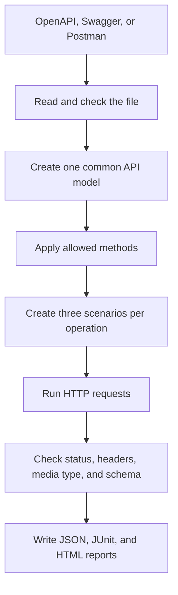

# How generation works

API Test Pilot separates reading an API description from choosing test data and sending requests. This makes one test engine work with OpenAPI, Swagger, and the supported part of Postman.

## One common model

The input formats use different names for the same ideas. OpenAPI has operations and schemas. Postman has saved requests and examples. API Test Pilot first turns both into a small common model: method, path, parameters, body, expected responses, and authentication needs.

Generation works from that model. It does not need a separate test strategy for each file format.

## Three views of each operation

For every allowed operation, generation creates:

- a **functional** scenario with examples, defaults, or small valid values;
- a **negative** scenario with one missing or invalid required value, a missing body, or an unknown path; and
- an **edge** scenario with values at documented limits.

The choice is deterministic: the same specification and configuration produce the same suite. Here, deterministic means that generation follows code rules rather than an AI answer or random choice.

Large values are capped. Strings stop at 256 characters and arrays stop at 20 items. This keeps an extreme value useful without allowing a specification to create an unexpectedly large request.

## Checks remain attached to the scenario

Each generated scenario stores accepted status codes. When the specification provides more detail, it also stores the response media type, required headers, and JSON Schema.

The runner checks those details after the request. Keeping them in the suite makes the test readable and lets the runner work without downloading the specification again.

## Format-specific code ends early

Only loading and translation know whether the source was OpenAPI or Postman. Request execution, response checks, reports, AI analysis, and notifications use the same scenario and result models.

That boundary is what makes the tool generic: a new input format can be added by translating it into the common model, without creating another runner.
