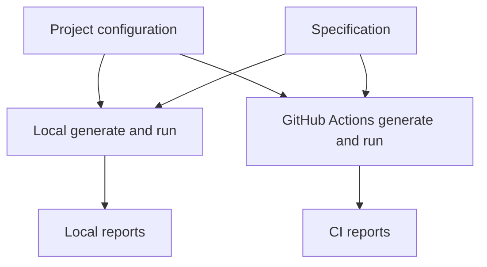

# One configuration for local and CI

A regression test is easier to trust when the command on a laptop and the command in GitHub Actions use the same target and rules.

## The configuration owns the choices

`.api-test-pilot/config.yaml` records:

- where the specification is;
- whether the server URL is replaced;
- which HTTP methods are allowed;
- which environment-variable names hold credentials; and
- where generated scenarios and reports go.

The file contains decisions that should be reviewed. Secret values remain in the local environment or GitHub Actions secrets.

## The suite is rebuilt from that file

The generated workflow does not keep a second list of endpoints or methods. It runs `generate --config ...` and then `run --config ...`, just like a local run can.

The scenario file is a build result. Regenerating it in CI avoids an old suite continuing to pass after the specification changes.

## One source reduces quiet differences

If local and CI settings were copied into separate commands, a base URL or allowed method could change in one place but not the other. A shared file turns that difference into a normal code review change.

The two environments can still behave differently when their networks, API data, or secrets differ. The shared configuration removes configuration drift; it does not remove environmental differences.
